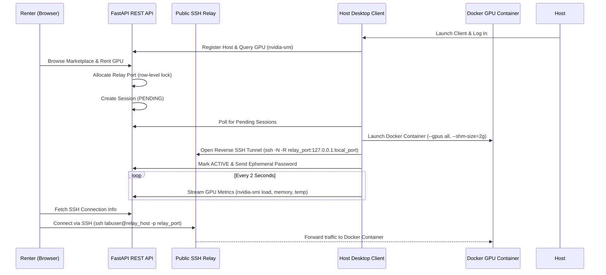

# Labhya Compute: Peer-to-Peer GPU Rental Platform

> **7th-Semester Undergraduate Capstone Project**  
> **Team Members:** Sugam Dahal, Sudip Niroula, Saurab Prasai  
> **Core Focus (Sugam Dahal):** System architecture, reverse SSH relay port-leasing logic (PostgreSQL `with_for_update()` row locking), Docker container sandboxing with GPU pass-through, and FastAPI REST API design.

[](https://opensource.org/licenses/MIT)
[](https://www.python.org/)
[](https://fastapi.tiangolo.com/)
[](https://sqlmodel.tiangolo.com/)
[](https://nextjs.org/)
[](https://www.postgresql.org/)
[](https://www.docker.com/)

Labhya Compute is an undergraduate capstone prototype designed to connect individuals who need compute power (renters) with users who have idle GPU hardware (hosts).

Because consumer GPUs usually sit behind residential firewalls or CGNAT, remote renters cannot connect to them directly. This project solves that by having a lightweight host agent open an outbound reverse SSH tunnel to a public relay bastion. Renters connect to the relay port, which forwards traffic into an isolated Ubuntu Docker container on the host machine with access to the host's NVIDIA GPU.

---

## Architecture Overview



### Key Engineering Elements
1. **NAT Traversal via Reverse SSH (`ssh -N -R`)**: Enables hosts behind residential routers to accept remote SSH connections without port forwarding or static public IPs.
2. **Concurrency-Safe Port Leasing**: In `backend/app/models.py`, `RelayPort.lease_free_port()` uses PostgreSQL row locks (`with_for_update()`) on ports 8001-8999 to prevent port collisions between simultaneous bookings.
3. **Container Sandboxing & GPU Access**: Containers are spun up with `--gpus all`, `--shm-size=2g`, and an ephemeral random password generated on launch. If the host lacks NVIDIA Container Toolkit, the agent falls back to a standard CPU container.
4. **Live Telemetry**: The desktop agent queries `nvidia-smi` every two seconds to send GPU load, memory usage, and temperature to the session dashboard.

---

## Quick Start

### Option 1: Docker Compose (Recommended)
Starts the PostgreSQL database, FastAPI backend, and Next.js frontend:

```bash
docker compose up --build
```
- Web Portal: [http://localhost:3001](http://localhost:3001)
- API Docs: [http://localhost:8080/docs](http://localhost:8080/docs)

---

### Option 2: Manual Local Setup

#### 1. Database
Create a PostgreSQL database named `labhya_compute`:
```sql
CREATE DATABASE labhya_compute;
```

#### 2. Backend API
```bash
cd backend
python -m venv venv
source venv/bin/activate  # On Windows: venv\Scripts\activate
pip install -r requirements.txt

# Start backend server
uvicorn app.main:app --reload --port 8000
```

#### 3. Frontend Portal
```bash
cd frontend
npm install
npm run dev
```
Open [http://localhost:3000](http://localhost:3000) in your browser.

#### 4. Host Desktop Client
```bash
cd backend/agent
pip install requests
python agent_gui.py
```
*Requirements: Docker Engine or Docker Desktop, OpenSSH client, and NVIDIA drivers (with nvidia-container-toolkit for GPU support).*

---

## Repository Structure

```text
Labya_compute/
├── backend/
│   ├── agent/
│   │   ├── docker/                # Dockerfile template for the renter container
│   │   └── agent_gui.py           # Tkinter host client for tunneling and metrics
│   ├── app/
│   │   ├── routers/               # API routes (auth, gpus, sessions, wallets, profiles)
│   │   ├── auth_utils.py          # Password hashing and JWT handling
│   │   ├── config.py              # Environment configuration loader
│   │   ├── db.py                  # Database connection setup
│   │   ├── models.py              # SQLModel schema and port leasing logic
│   │   ├── schemas.py             # Pydantic request and response schemas
│   │   └── main.py                # FastAPI entrypoint
│   ├── requirements.txt
│   └── Dockerfile
│
├── frontend/
│   ├── app/                       # Next.js App Router pages
│   ├── components/                # Reusable UI components
│   ├── hooks/                     # Custom React hooks
│   ├── lib/                       # API client, store, and types
│   ├── package.json
│   └── Dockerfile
│
└── docker-compose.yml             # Local compose orchestration
```

---

## Database Models

| Model | Purpose |
| :--- | :--- |
| **`User`** | Stores account credentials and basic user profile data. |
| **`Host`** | Links a user to hardware hosting capabilities. |
| **`Renter`** | Links a user to rental sessions and GPU leases. |
| **`Wallet`** | Tracks NPR account balances for deposits and payouts. |
| **`Transaction`** | Ledger of deposits, withdrawals, and rental payments. |
| **`GPU`** | Hardware listing with specs, hourly price, and status. |
| **`Session`** | Active or past rental agreement with SSH connection details and metrics. |
| **`RelayPort`** | Tracks assigned ports (8001-8999) on the relay server to avoid conflicts. |

---

## Relay Bastion Configuration

For production use with a public VPS as the relay:
1. Enable gateway ports in `/etc/ssh/sshd_config`:
   ```text
   GatewayPorts yes
   ClientAliveInterval 60
   ClientAliveCountMax 3
   ```
2. Open ports 8001-8999 in your firewall for incoming renter SSH traffic.
